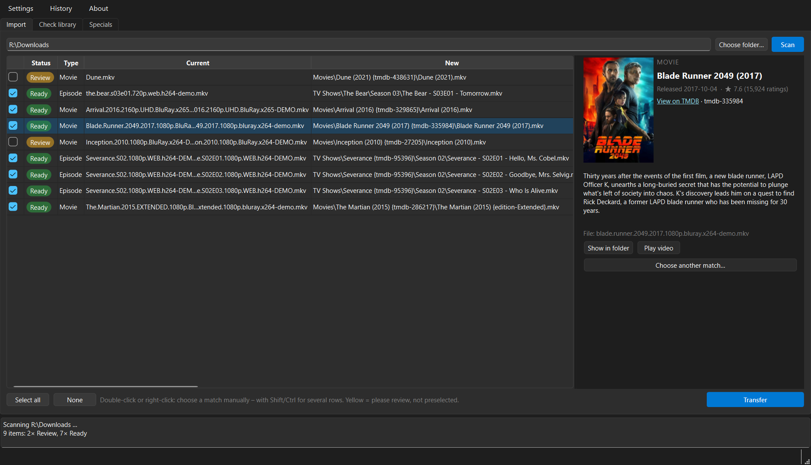
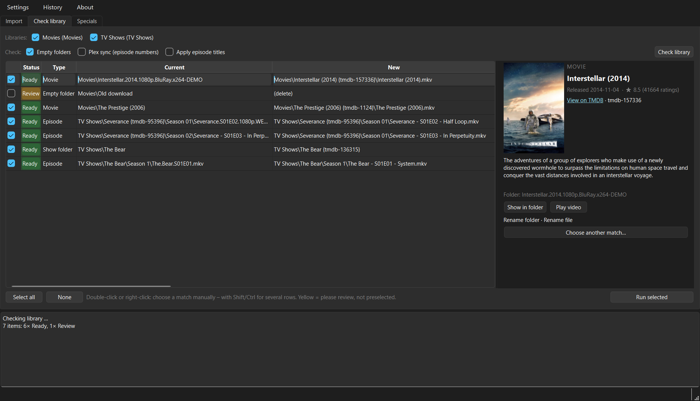

# ShelfSort

**Sort downloaded movies and TV shows into your Plex library – named the way Plex expects, with the episode numbers Plex actually uses.**

ShelfSort is a small desktop app for Windows and Linux. Point it at a download folder: it recognises every movie and episode, finds it on TMDB, shows you what it will do, and moves the files into your Plex library with clean names. It can also check the library you already have and fix what is wrong.

[Deutsch](README.de.md) · [Download](https://github.com/Obilarius/shelfsort/releases/latest) · [Changelog](CHANGELOG.md)



> ShelfSort is an independent project and not affiliated with Plex, Inc. “Plex” is a trademark of Plex, Inc.

## What makes it different

Most renamers number episodes the way TMDB or TheTVDB does. Plex, though, numbers them by the **episode ordering set for each show** – and for many shows that is not the default (Doctor Who in BBC iPlayer order, crime shows in DVD order, kids’ shows where TMDB and TheTVDB disagree). A file named after the “wrong” ordering shows up in Plex as the wrong episode or not at all.

ShelfSort asks your Plex server which ordering each show uses and names the files to match:

- **Plex sync** – compares every episode in your library with the episode list Plex uses for that show and suggests corrected numbers, e.g. a Christmas special moved from `S07E00` to `S06E14`, or a season that is off by one.
- **Specials check** – Plex skips season 0 in “Continue watching”. ShelfSort shows, per show, which of the orderings available in Plex puts the specials into the regular seasons, and switches the show to it on request.

## Features

- **Import from download folders** – subfolders are scanned too; messy release names (`Some.Movie.2016.German.DL.1080p.BluRay.x264.mkv`) are taken apart. Subtitles move along with their video.
- **You decide** – every planned rename is listed first. Green = sure match (preselected), yellow = please review, red = conflict. Wrong match? Double-click and search TMDB yourself, with covers and descriptions.
- **Safe transfer** – across drives files are copied to `*.partial`, the size is checked, and only then is the original removed. Progress, speed and time left are shown; cancelling leaves the original untouched.
- **Check library** – wrong folder or file names, missing year or TMDB ID, episodes in the wrong season folder, missing episode titles, duplicates, empty folders.
- **Several libraries** – e.g. “Movies”, “Kids”, “TV Shows”; one default per type for new imports, each with its own title language (useful for an original-language library).
- **Undo** – every run is recorded; **History** shows it and puts everything back.
- **Plex scan** – afterwards only the changed folders are rescanned.
- **German and English** user interface.



Naming scheme (the one Plex recommends):

| | Example |
|---|---|
| Movie | `Movies/Blade Runner 2049 (2017) {tmdb-335984}/Blade Runner 2049 (2017).mkv` |
| Episode | `TV Shows/Doctor Who {tmdb-57243}/Season 06/Doctor Who - S06E01 - The Impossible Astronaut.mkv` |

## Installation

**Windows 10/11:** download `ShelfSort-<version>-windows-x64.zip` from [Releases](https://github.com/Obilarius/shelfsort/releases/latest), unzip it anywhere and start `ShelfSort.exe`. No installer, nothing is written outside the folder except your settings.

**Linux (x64):** download `ShelfSort-<version>-linux-x64.tar.xz`, then

```bash
tar -xf ShelfSort-*-linux-x64.tar.xz
```

and start `ShelfSort/ShelfSort`. Built on Ubuntu 22.04, so it runs on that and newer distributions.

**From source** (any system with Python 3.12): see [CONTRIBUTING.md](CONTRIBUTING.md).

## Getting started

On first start a setup wizard asks for:

1. **Language** – of the app and of the titles (movie and episode names).
2. **TMDB API key** – free: create an account on [themoviedb.org](https://www.themoviedb.org/signup), then *Settings → API* and request a key (“Developer”, personal use). Paste the “API Key” or the “API Read Access Token” – both work.
3. **Plex sign-in** – opens plex.tv in your browser. ShelfSort only receives an access token, never your password. You can also continue without Plex; then renaming and moving work, but no Plex scan, Plex sync or specials check.
4. **Server** – found through your Plex account; ShelfSort tests which address is reachable from this computer.
5. **Libraries** – tick the movie and TV libraries ShelfSort should manage. It finds where their folders are on this computer (Plex may see `/data/movies` while this computer sees `X:\Media\movies` or `/mnt/media/movies`) and checks that against real files.

Then: **Import** → choose your download folder → **Scan** → check the list → **Transfer**.

Everything can be changed later under **Settings**, the wizard can be run again from there.

## FAQ

**Windows says “Windows protected your PC”.**
The program is not code-signed (that costs money every year). Click *More info → Run anyway*. The builds are made by GitHub Actions straight from this repository’s source.

**Linux: it does not start / “could not load the Qt platform plugin xcb”.**
Install the XCB cursor library, which newer Qt versions need: `sudo apt install libxcb-cursor0` (Debian/Ubuntu) or `sudo dnf install xcb-util-cursor` (Fedora). Start it from a terminal to see the error message.

**Does ShelfSort delete anything?**
Only two things, and only with your OK: release folders that are empty after the import go to the **recycle bin**; empty folders found by *Check library* are never preselected and are deleted permanently (network shares have no recycle bin) after an extra warning.

**Something went wrong – can I go back?**
**History** lists every run with all changes. *Undo* moves files and folders back. Anything that has changed since is skipped, never overwritten.

**An episode got the wrong number.**
Check which episode ordering the show uses in Plex (*Edit → Advanced → Episode ordering*) – ShelfSort follows it. The *Specials* tab shows the orderings side by side.

**Where are my settings? How do I uninstall?**
Settings, history and log file are in `%APPDATA%\ShelfSort` (Windows) or `~/.config/ShelfSort` (Linux). To uninstall, delete the program folder and that folder.

**Something does not work.**
Please [open an issue](https://github.com/Obilarius/shelfsort/issues) and attach the log file (*History → Open log file*). Remove anything private from it first; it contains file and folder names.

## Privacy

ShelfSort has no telemetry and no account of its own. It talks to:

- **TMDB** (`api.themoviedb.org`, `image.tmdb.org`) – searching titles, loading covers, with your own API key.
- **Plex** – `plex.tv` for sign-in and finding your server, your own Plex server, and Plex’s metadata service `metadata.provider.plex.tv` for the episode orderings.
- **GitHub** (`api.github.com`) – once a day, to see whether a new version is out. Nothing is downloaded or installed automatically; a new version is shown at the bottom right of the window. Can be turned off under *Settings → General*.

Your TMDB key and Plex token are stored only in the settings file on your computer.

## Good to know

- Plex’s metadata service is **not officially documented** and may change. If it fails, episode titles come from TMDB and the Plex sync is skipped with a notice – import and the name check keep working.
- This product uses the TMDB API but is not endorsed or certified by TMDB.

## Support

ShelfSort is free and stays free – no paid features, no ads. If it saves you time, you can [buy me a coffee on Ko-fi](https://ko-fi.com/obilarius) ☕

## License

MIT, see [LICENSE](LICENSE). Libraries used and their licenses: [THIRD_PARTY_LICENSES.md](THIRD_PARTY_LICENSES.md).
